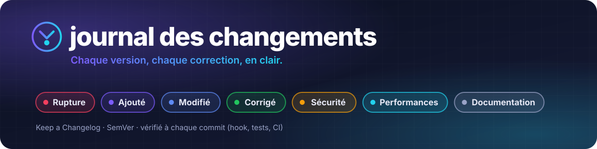

 

# Journal des changements

Tout ce qui change dans Grasp, version par version, **la plus récente en haut**. Chaque ligne dit ce que vous
pouvez faire de nouveau, ce qui se comporte autrement ou ce qui est réparé ; le détail est dans le
[README](README.md).

## 🗺️ En un coup d'œil

| Version | Date | Thème | Les points forts |
|:--|:--|:--|:--|
| **[0.5.0](#050--2026-11-12--retours-du-troisième-essai-réel)** | 12 nov. 2026 | Retours du 3e essai réel | `css >> nth=N`, candidats d'un sélecteur ambigu, outil MCP `expect`, journal obligatoire |
| **[0.4.0](#040--2026-11-12--mise-en-page-sans-eval)** | 12 nov. 2026 | Mise en page sans eval | `expect in-viewport` / `not-clipped` / `no-horizontal-overflow`, `--boxes`, `storage --origin` |
| **[0.3.0](#030--2026-11-12--treize-chantiers)** | 12 nov. 2026 | Treize chantiers | onglets, réseau, secrets, dialogues, historique, viewport, audits, frontières de contenu |
| **[0.2.0](#020--2026-11-12--mcp-accès-distant-et-recette)** | 12 nov. 2026 | MCP, accès distant et recette | `grasp mcp`, proxy et certificats, `expect`, `state`, Docker, protection SSRF |
| **[0.1.0](#010--2026-11-02--le-socle)** | 2 nov. 2026 | Le socle | CDP direct, snapshot à refs, profils, Windows depuis WSL2, `run`, moteur Playwright |

### Légende

| | Catégorie | Ce qu'on y range |
|:-:|:--|:--|
| 💥 | **Rupture** | Un script, une option ou une route qui marchait ne marche plus pareil : à lire avant de mettre à jour |
| ✨ | **Ajouté** | Commande, option, outil MCP ou route nouvelle |
| 🔄 | **Modifié** | Comportement ou sortie qui change, sans rien casser |
| ⚠️ | **Déprécié** | Encore là, mais à remplacer : retrait annoncé |
| 🗑️ | **Retiré** | Supprimé |
| 🐛 | **Corrigé** | Défaut réparé |
| 🔒 | **Sécurité** | Allowlist, SSRF, secrets, frontières de contenu, permissions |
| ⚡ | **Performances** | Plus rapide, plus léger, moins de tokens |
| 📝 | **Documentation** | README, aide, `grasp skill`, quand la doc change seule |

<b>📏 Règles du journal</b> (obligatoire, vérifié à chaque commit)

 

- **Toute modification du code ajoute sa ligne ici**, sous `## [Non publié]` : `src/`, `skills/`, `docker/`,
  `data/`, `Dockerfile` ou `package.json`. Les tests, le README et le TODO seuls n'en ont pas besoin.
- **Une ligne = un effet visible**, écrit pour quelqu'un qui utilise Grasp : la commande en `code`, puis ce qui
  change. Pas de nom de fonction interne, pas de « refactor ».
- **Catégories** : celles de la légende, dans cet ordre, sans en inventer.
- **Publier une version** : renommer `## [Non publié]` en `## [X.Y.Z] — AAAA-MM-JJ · Thème`, recréer un
  `## [Non publié]` vide au-dessus, mettre la même version dans `package.json`, ajouter les liens en bas,
  puis étiqueter le commit `vX.Y.Z`.
- **Exception** : un commit sans effet visible (renommage, commentaire) peut porter `[sans changelog]` dans son
  message.

**Les garde-fous**

| Où | Quoi |
|:--|:--|
| `git commit` | Le hook `.githooks/commit-msg` refuse un commit qui touche le code sans toucher ce fichier. Il est installé par `npm install` (`core.hooksPath`). |
| `npm test` | `test/unit/changelog.test.ts` vérifie le format, l'ordre des versions et l'accord avec `package.json`. |
| GitHub | Le workflow « Journal des changements » rejoue les deux vérifications sur chaque push et chaque PR. |
| À la main | `npm run changelog` |

---

## [Non publié]

_Rien pour l'instant._

---

## [0.5.0] — 2026-11-12 · Retours du troisième essai réel

> 🎯 Recette Dexyu v3 : **46/50**, et les 4 échecs sont de vrais défauts de l'application testée. Les six
> frictions relevées pendant l'essai sont levées.

### ✨ Ajouté

- **`<css> >> nth=N`** vise le N-ième élément d'un sélecteur CSS (à partir de 0), sans deviner un
  `:nth-child`. Marche aussi dans `expect sel` / `no-sel` ; au-delà du nombre d'éléments : 404
  « N élément(s) seulement ».
- **Sélecteur ambigu** : le 409 liste jusqu'à 5 candidats, avec leur balise, leur boîte `@x,y LxH` et un
  sélecteur unique à réutiliser tel quel.
- **Outil MCP `expect`** : la même syntaxe que la CLI (`assertion` = la ligne sans le mot `expect`). Grasp expose
  désormais 30 outils MCP.
- **Ce journal**, obligatoire : hook `commit-msg`, test unitaire, workflow GitHub et `npm run changelog`.

### 🔄 Modifié

- **Rapport de `run`** : le `--ignore` d'une étape `expect no-console-errors` réussie s'applique aussi au résumé
  final, dans la seule fenêtre examinée par l'étape (« N entrées ignorées (--ignore de l'étape [k]) »).
- **`state import` dans un script `run`** : chemins relatifs au dossier du script (au répertoire courant quand
  le script arrive par stdin). Une recette se déplace avec ses fichiers d'état.
- **`snap` / `find --boxes`** : l'en-tête annonce « layout LxH » (et le viewport émulé s'il diffère) ; la mention
  des 980 px n'apparaît plus que sans `<meta viewport>`.

### 🐛 Corrigé

- MCP : les erreurs d'ambiguïté n'affichent plus de candidats « undefined ».

### 📝 Documentation

- `storage get` lit l'état **actuel** : pour une session factice, vérifiez par la page (encadré dans « Session
  factice sans allowEval »).
- Les écarts de schéma entre les outils MCP et la CLI sont listés dans le README.

---

## [0.4.0] — 2026-11-12 · Mise en page sans eval

> 📐 Retours du deuxième essai réel (Dexyu v2 : **39/42**) : vérifier la mise en page et le stockage sans jamais
> exécuter de JavaScript dans la page.

### ✨ Ajouté

- **`expect in-viewport <sél> [--fully]`**, **`expect not-clipped <sél>`** et **`expect no-horizontal-overflow`** :
  les défauts de mise en page vérifiés depuis la recette, éléments fixes et `visibility:hidden` compris.
- **`--boxes`** sur `snap` et `find` : la boîte `@x,y LxH` de chaque ligne à ref (« fixe » pour un élément fixe,
  `@aucune-boîte` s'il n'est pas rendu).
- **`storage --origin <url>[,…]`** : lire le stockage d'autres origines de l'allowlist.
- **`state import`** utilisable comme étape d'un script `run`.
- **Outils MCP** `storage` (avec `origin`) et `state_import`.

### 🔄 Modifié

- Un `eval` refusé propose les alternatives (`storage --origin`, assertions de mise en page, `--boxes`) au lieu
  d'inviter à activer `allowEval`.
- Les captures d'échec de `run` sont écrites sous `--out-dir`, et leur plafond est annoncé.
- Notes viewport plus explicites : page sans `<meta viewport>`, `about:blank` avant toute navigation. La note
  storage n'est plus répétée.
- `grasp skill` repasse sous sa borne de 14 Ko.

### 🔒 Sécurité

- Le corps de `POST /run` est borné et mesuré.

### 📝 Documentation

- `console --level error` et la base des chemins d'un `run` documentés.

---

## [0.3.0] — 2026-11-12 · Treize chantiers

> 🧰 Retours du premier essai réel (Dexyu v1) et tout l'outillage d'une vraie recette : onglets, réseau,
> secrets, dialogues, historique et audits.

### ✨ Ajouté

- **Onglets et popups** : `tabs`, `tab <id>|new|close`, `--follow`, retour d'un flux OAuth.
- **Journal réseau** : `grasp network`, `--network` sur les actions, `expect request`.
- **Secrets** : `fill <sél> secret:NOM`, valeur gardée côté serveur et limitée à des domaines ;
  `secrets list|set|rm`.
- **Dialogues** : `--dialog accept|dismiss|"texte"` par action, dialogues rapportés en fin d'action.
- **Historique** : `grasp history [--since]` et `--as-run`, qui produit un script `run` rejouable.
- **Navigation** : `back`, `forward`, `reload [--hard]`, `scroll [--until-stable]`.
- **Viewport** : `grasp viewport`, appareils prédéfinis, `session create --viewport`.
- **Lecture progressive** : `snap --outline`, `snap --interactive` et `find`.
- **Stockage** : `grasp storage get|set|rm local|session`, session factice sans `allowEval`.
- **Accessibilité** : `grasp a11y` et `expect a11y`.
- **Recette multipage** : `grasp diff` (deux environnements, page par page) et `grasp audit` (sitemap ou liste).
- **Aide pour agents** : `grasp skill`, `grasp help --json` et `skills/grasp/SKILL.md`.
- **Outils MCP** `network`, `a11y`, `tabs`, `tab`, `viewport` et `history`.
- `screenshot -o <fichier relatif>` dans un `run`, écrit sous `--out-dir`.

### 🐛 Corrigé

- Sockets : repli court et haché sous `/tmp/grasp-<uid>` quand le chemin dépasse 107 octets.
- `console --level error` n'affiche plus les repères de navigation ; `about:blank` n'est plus écrit « nullblank ».
- Un texte passé à `--dialog` ne confirme plus un `confirm()`.
- `back` / `forward` / `reload` : une iframe hors allowlist ne les fait plus échouer, un serveur injoignable
  répond 502 comme `nav`.
- `grasp audit` : un lien contenant un `%` isolé ne fait plus échouer tout l'audit.
- Audit a11y : les icônes svg sans rôle ne passent plus pour des images sans alt ; une erreur reliée par
  `aria-describedby` est reconnue.

### 🔒 Sécurité

- **Frontières de contenu** (`contentBoundaries`) : tout contenu issu de la page est encadré par un nonce,
  contre l'injection de prompt.
- Secrets masqués dans toutes les sorties, sans oracle par `expect`, `wait --text` ou `text:`.
- URL masquées dans les notes d'onglets.

---

## [0.2.0] — 2026-11-12 · MCP, accès distant et recette

> 🌍 Grasp sort du poste de développement : serveur MCP, serveurs distants, Docker, sessions parallèles et
> premières recettes automatisées.

### ✨ Ajouté

- **Serveur MCP** : `grasp mcp` (stdio, JSON-RPC 2.0), sans dépendance supplémentaire.
- **Accès distant** : proxy par session, règles de résolution, certificats par hôte, HTTP basic par session.
- **Recette** : `grasp expect` (texte, URL, titre, élément, valeur, console, formulaire) et rapport de fin de
  `run` (`--report`), avec capture à l'échec.
- **État** : `grasp state export|import` (cookies, localStorage par origine, sessionStorage).
- **`text --markdown`** : le contenu visible converti en Markdown.
- **Image Docker** : Chromium + Node 22, non-root, sandbox conservée ; écoute TCP hors boucle locale en opt-in
  (`serve --tcp --listen IP`).
- **Sessions parallèles** et recyclage du navigateur : `browserMaxRssMb`, `browserMaxAgeMin`, `maxSessions`.
- **Blocage des traqueurs** (liste de Peter Lowe), clé `blockTrackers`.
- Mode attach dans `e2e.sh` et les tests (`GRASP_CDP_URL`, `GRASP_TEST_CDP_URL`).

### 🐛 Corrigé

- Un sandbox indisponible est nommé, au lieu d'être pris pour un profil verrouillé.
- Snapshot : le titre est relu dans le document quand la racine de l'arbre n'a pas de nom.

### 🔒 Sécurité

- **Protection SSRF** : un nom admis par l'allowlist ne mène plus au réseau privé.

### 📝 Documentation

- README : bannière, badges, chiffres clés, comparatif et section « Tester un serveur distant ».
- Évaluation d'Obscura comme moteur léger derrière Grasp (mode attach).

---

## [0.1.0] — 2026-11-02 · Le socle

> 🌱 Chrome piloté par l'arbre d'accessibilité, en CDP direct, avec une seule dépendance d'exécution.

### ✨ Ajouté

- **Transport CDP direct**, snapshot de l'arbre d'accessibilité à refs stables, actions, control plane HTTP et CLI.
- **Mode attach** (`cdpUrl`) : piloter un Chrome existant, y compris Chrome Windows depuis WSL2.
- **Profils** : création, import d'un profil Chrome, bascule sans navigateur orphelin.
- **Captures d'écran** et **console** du navigateur.
- **Lectures bornées**, attente de stabilité (DOM et réseau), élagage annoncé.
- **`grasp run`** : scripts d'actions exécutés étape par étape, livraison des entrées vérifiée.
- **Moteur Playwright de repli** : `--engine playwright`, `frame=` dans les iframes.
- **Snapshot v3** : validité des champs exposée, libellés répétés, boutons sans nom, options, modales.
- **Navigation** : challenges anti-bot suivis, diff des SPA, `fill` sur éditeur riche.
- `snap --name-max N` et `console --limit`.

### 🐛 Corrigé

- Une ref n'est jamais relocalisée sur un homonyme ; captures larges et hautes ; console sans perte silencieuse.
- Un élément remplacé après `fill` / `type` / `click` est signalé, et l'ancienne ref vise le remplaçant.
- Stabilité : les requêtes de fond et les animations continues de faible ampleur n'empêchent plus de conclure.

### 🔒 Sécurité

- Allowlist de navigation, token du control plane, permissions des fichiers vérifiées.
- Port DevTools choisi par Grasp : `navigator.webdriver` reste à `false`.

---

Les versions 0.1.0 à 0.4.0 ont été reconstituées le 12 novembre 2026 à partir de l'historique git ; leurs
étiquettes pointent sur le dernier commit de chaque étape.

[Non publié]: https://github.com/Flo976/grasp/compare/v0.5.0...HEAD
[0.5.0]: https://github.com/Flo976/grasp/compare/v0.4.0...v0.5.0
[0.4.0]: https://github.com/Flo976/grasp/compare/v0.3.0...v0.4.0
[0.3.0]: https://github.com/Flo976/grasp/compare/v0.2.0...v0.3.0
[0.2.0]: https://github.com/Flo976/grasp/compare/v0.1.0...v0.2.0
[0.1.0]: https://github.com/Flo976/grasp/releases/tag/v0.1.0
