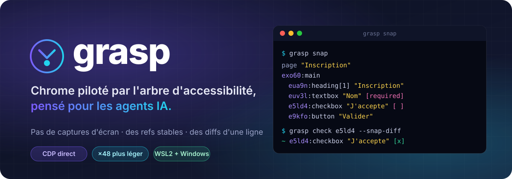

<div align="center">



<br>

[](.nvmrc)
[](tsconfig.json)
[](#architecture)
[-7c5cff?style=for-the-badge)](package.json)
[](package.json)

**Votre agent ne regarde pas l'écran : il lit la page.**

[Démarrage rapide](#démarrage-rapide) ·
[Snapshot](#snapshot) ·
[Commandes](#commandes) ·
[Mode Windows](#mode-windows-chromeexe-depuis-wsl2) ·
[Sécurité](#sécurité) ·
[Limites](#limites-connues)

</div>

---

## ✨ En bref

Grasp est un serveur qui pilote Chrome pour les agents IA. Par défaut, l'agent ne reçoit pas de
captures d'écran. Il lit **l'arbre d'accessibilité aplati**, une ligne par nœud utile, et agit
par **références stables**. Quand l'image est vraiment nécessaire, `grasp screenshot` écrit un
fichier et ne renvoie que son **chemin**. Pour déboguer, `grasp console` lit le journal du
navigateur (logs, exceptions, requêtes en échec).

```
page "Inscription" http://127.0.0.1:45457/
eaug9:navigation
 ee0rz:link "Accueil"
exo60:main
 eua9n:heading[1] "Inscription"
 et2s5:form
  euv3l:textbox "Nom" [required]
  ecgzh:combobox "Pays"="--" [-]
  e5ld4:checkbox "J'accepte les conditions" [ ]
  e9kfo:button "Valider"
 "En attente"
```

<table>
<tr>
<td align="center" width="25%"><h3>388 o</h3>snapshot de la page de test<br><sub>contre 18,7 Ko pour un PNG en base64</sub></td>
<td align="center" width="25%"><h3>×48</h3>plus léger<br><sub>qu'une capture d'écran</sub></td>
<td align="center" width="25%"><h3>1 ligne</h3>de diff après un <code>fill</code><br><sub>avec <code>--snap-diff</code></sub></td>
<td align="center" width="25%"><h3>1 dép.</h3><code>ws</code>, c'est tout<br><sub>ni Playwright, ni Puppeteer</sub></td>
</tr>
</table>

Sur une vraie page, chaque lecture est **bornée par défaut** : `text` et `--snap-diff` à 4000
caractères, `snap` à 12 000 octets. Toute coupure est annoncée en dernière ligne, et `--scope`
limite la lecture à une zone.

## 🧭 Pourquoi Grasp

| | Captures d'écran | DOM brut | **Grasp** |
|---|---|---|---|
| Coût en tokens | 💸 élevé | 💸💸 très élevé | ✅ borné et annoncé |
| Cibler un élément | coordonnées fragiles | sélecteurs fragiles | ✅ refs stables (rôle + nom) |
| Voir l'effet d'une action | nouvelle capture | tout relire | ✅ `--snap-diff` : seulement ce qui change |
| Page qui charge encore | à deviner | à deviner | ✅ attente de stabilité DOM + réseau |
| Saisie silencieusement perdue | invisible | invisible | ✅ livraison vérifiée, valeur relue |
| Erreurs de formulaire cachées | visibles si affichées | à chercher | ✅ `[invalide: <message>]` sur la ligne du champ |

## 🧩 Ce que Grasp sait faire

- 🌳 **Snapshot d'accessibilité** compact, avec des refs qui restent valides quand la page bouge
  ([détails](#snapshot)).
- 🔁 **Diffs après action** : `+` apparu, `-` disparu, `~` modifié, calculés sur un DOM stable.
- ⏱️ **Attente intelligente** : DOM et réseau calmes, redirections et challenges anti-bot suivis
  ([détails](#attente-de-stabilité)).
- 🎯 **Livraison vérifiée des entrées** : un clic ou une saisie qui n'arrive pas est détecté et
  repris ([détails](#livraison-vérifiée-des-entrées)).
- 👤 **Profils persistants** : cookies et connexions gardés d'une session à l'autre, import d'un
  profil Chrome existant ([détails](#profils)).
- 🪟 **Chrome Windows depuis WSL2**, pour les sites qui bloquent Chrome headless
  ([détails](#mode-windows-chromeexe-depuis-wsl2)).
- 🕵️ **`navigator.webdriver` à `false`** grâce à un port DevTools choisi par Grasp
  ([détails](#port-devtools-et-navigatorwebdriver)).
- 📜 **`grasp run`** : plusieurs commandes en un seul appel.
- 🎭 **Moteur Playwright de repli**, optionnel, branché sur le même Chrome (iframes d'autres origines…).
- 🔒 **Sécurité par défaut** : allowlist de navigation, token, socket Unix ([détails](#sécurité)).

## 🛠️ Stack

- TypeScript strict, Node 22+, ESM, `node:http`, CDP en direct via `ws`. Le cœur n'utilise ni
  Playwright ni Puppeteer ; un [moteur Playwright de repli](#moteur-playwright-de-repli)
  **optionnel** se branche sur le même Chrome.
- Linux (desktop et conteneur), et Chrome Windows piloté depuis WSL2 (voir
  [Mode Windows](#mode-windows-chromeexe-depuis-wsl2)). macOS en best-effort.
- Tests : `node:test` uniquement, contre un vrai Chrome et un site local. Aucun site externe.

## Démarrage rapide

```bash
npm install && npm run build
node dist/src/cli/main.js doctor          # diagnostic réel, Chrome démarré pour de vrai
npm link                                   # optionnel : commande `grasp`

grasp serve &                              # ou : grasp daemon install (systemd user)
export GRASP_SESSION=$(grasp session create)
grasp nav http://127.0.0.1:8080/
grasp snap
grasp fill e5k2 "Ada"                      # ref issue du snap
grasp click text:Valider --snap-diff
grasp wait --text "Inscription reçue"      # contenu tardif (nav et --snap-diff attendent déjà la stabilité)
grasp text                                 # vérifier le résultat dans la page
grasp stop
```

## Scénario de bout en bout (reproductible)

[`examples/e2e.sh`](examples/e2e.sh) démarre le site de test local, un serveur Grasp isolé
(XDG temporaires, rien n'est écrit chez vous), puis navigue, prend un snapshot, remplit trois
champs avec les trois formes de sélecteur, choisit dans une liste, coche une case, soumet, et
**vérifie le résultat par le contenu de la page**, car une action qui réussit prouve seulement
que l'événement a été émis.

```bash
npm run build && bash examples/e2e.sh
```

```
grasp nav "$URL/"
grasp snap
grasp fill "$NOM" "Ada Lovelace"              # ref
grasp fill '#email' 'ada@example.org'          # CSS
grasp fill 'text:Ville' 'Antananarivo'         # texte accessible
grasp select 'text:Pays' 'Madagascar'
grasp check "text:J'accepte les conditions" --snap-diff
  ~ e5ld4:checkbox "J'accepte les conditions" [x] [focus]
grasp click 'text:Valider' --snap-diff
  navigation → http://127.0.0.1:45457/submit?nom=Ada+Lovelace&…
  page "Merci" …
  euy6r:heading[1] "Inscription reçue"
   "Nom : Ada Lovelace"
   …
grasp text | grep 'Nom : Ada Lovelace'         # la preuve, c'est la page
SCÉNARIO VALIDÉ
```

Ce script est exécuté par la suite de tests (`test/integration/readme-e2e.test.ts`) : si le
README dérive du code, `npm test` échoue.

## Architecture

```
 grasp (CLI) ──HTTP──▶ control plane ──HTTP/socket Unix──▶ bridge ──CDP/WebSocket──▶ Chrome
 client mince          profils, sessions,      (1 par instance)    garde de navigation,      (groupe de
                       token, politique                            snapshot, actions          processus)
```

| Processus | Rôle | Source |
|---|---|---|
| **CLI** | Client mince : parse, appelle l'API, formate. Aucune logique métier. Syntaxe des commandes partagée avec `grasp run` (`src/core/script.ts`). | `src/cli/main.ts` |
| **Control plane** | Serveur HTTP local (socket Unix ou TCP loopback), token, sessions, politique ; exécute les scripts de `grasp run` étape par étape vers le bridge (`src/control/run.ts`). | `src/control/server.ts` |
| **Bridge** | Un processus par Chrome. Détient la connexion CDP, le garde, le snapshot, les actions. | `src/bridge/` |

Le control plane ne parle jamais CDP, et le bridge n'a ni token ni config : il reçoit la
politique gelée à son lancement, par le canal IPC.

## Profils

Modèle pinchtab : **un profil = un `--user-data-dir` complet possédé par Grasp**, choisi AVANT de
lancer le navigateur. Les cookies, le stockage local et les connexions persistent d'une session à
l'autre ; deux profils ne partagent rien.

```bash
grasp profiles create florent --use-when "comptes perso"
grasp profiles create sooatek
grasp profiles                                   # * = profil de la session courante
* florent  prof_231b0997  -  session s13fadfae77fd  (comptes perso)
  sooatek  prof_18cdceb1  -
grasp session create --profile florent           # profil créé à la volée s'il n'existe pas (conseil sur stderr)
grasp profile sooatek                            # l'agent change lui-même de profil
grasp profiles rm sooatek                        # refusé (409) tant qu'une session l'utilise
```

- **Stockage** : `<racine>/<id>/`, avec `profile.json` (`id`, `name`, `createdAt`, `lastUsedAt`,
  `source` = `created`|`imported`, `importedFrom`, `useWhen`). `id` = `prof_` + 8 premiers hex du
  SHA-256 du nom ; noms `[A-Za-z0-9_.-]{1,64}`. Répertoires `0700`, fichiers `0600` (sauf NTFS).
- **Identité** : `accountEmail` et `accountName` sont lus, en lecture seule, dans
  `Default/Preferences` (`account_info`) puis `Local State` (`profile.info_cache`).
- **Bascule** (`grasp profile <nom>`, `POST /sessions/<id>/profile`) : le control plane arrête le
  bridge et son navigateur (fermeture propre par `Browser.close`, pour que les cookies soient écrits),
  puis relance sur le `--user-data-dir` du profil **en gardant l'identifiant de session**. La page
  repart de `about:blank`. Si le nouveau profil ne démarre pas, la session est rouverte sur l'ancien
  (502 explicite). Le profil cible doit exister (404 sinon, avec la liste) : une faute de frappe ne
  crée pas de profil en silence. Une session sans `--profile` (éphémère) peut basculer ; son répertoire
  temporaire est alors supprimé.
- **Mode attach** (`cdpUrl`) : le profil est celui du navigateur existant ; `--profile` et la bascule
  répondent 400.

### Import d'un profil Chrome existant

```bash
# répertoire de données complet (copie)
grasp profiles import perso ~/.config/google-chrome
# un seul profil d'un répertoire de données : copié vers Default/
grasp profiles import sooatek "/mnt/c/Users/<vous>/AppData/Local/Google/Chrome/User Data" --profile-directory "Profile 9"
```

- La source n'est **jamais modifiée**. Copie dans un dossier caché puis renommage : un import
  avorté ne laisse rien.
- Avec `--profile-directory`, un `Local State` minimal est écrit : `os_crypt` conservé (clé de
  déchiffrement des cookies) et l'entrée `info_cache` du profil renommée `Default`.
- Exclus : `Cache`, `Code Cache`, `GPUCache`, `DawnCache` (et variantes Dawn/Graphite),
  `ShaderCache`, `GrShaderCache`, `GPUPersistentCache`, `Service Worker/CacheStorage` et
  `ScriptCache`, `Crashpad`, `Singleton*`, `lockfile`, `*.lock`, `DevToolsActivePort`.
- Refusés : liens symboliques, source qui ne ressemble pas à un profil Chrome (pas de `Local State`
  ni de dossier avec `Preferences`), `--profile-directory` absent (la liste des profils est donnée).
- **Fichier verrouillé** (Chrome source ouvert : sous Windows, `Network/Cookies` d'un profil ouvert
  est illisible) : échec 409 qui liste les fichiers et conseille de fermer Chrome ; `--skip-locked`
  importe sans eux et les liste en avertissement.
- **Avertissements** (sur stderr, et `warnings` dans la réponse JSON) : source chiffrée par Chrome
  Windows (disque `/mnt/<lecteur>/`, clé `os_crypt` DPAPI ou app-bound) importée dans un Grasp en
  mode Linux — cookies et identifiants illisibles, le profil s'ouvrira déconnecté même si le compte
  est affiché ; `--profile-directory` sans `Local State` en mode Windows — clé `os_crypt` absente.
- Un profil importé n'emporte pas forcément ses connexions : voir les limites ci-dessous.

## Mode Windows (chrome.exe depuis WSL2)

Le Chrome Linux headless se fait bloquer par Cloudflare sur certains sites ; le vrai Chrome Windows
passe. Grasp le pilote directement depuis WSL2 :

```bash
grasp config set chromePath "/mnt/c/Program Files/Google/Chrome/Application/chrome.exe"
grasp config set headless false        # facultatif : fenêtre visible côté Windows
grasp doctor                           # signale le mode windows, démarre chrome.exe pour de vrai
```

- **Détection** : un chemin `*.exe` sous `/mnt/<lecteur>/` est classé `windows`. La version est lue
  dans le dossier de version voisin (`…\Application\156.0.8078.76\`) : `chrome.exe --version`
  ouvrirait une fenêtre dans le Chrome de l'utilisateur.
- **Profils côté Windows** : le chiffrement DPAPI des cookies exige que chrome.exe lise lui-même ses
  profils. Racine par défaut `%LOCALAPPDATA%\grasp\profiles` (résolu par `cmd.exe /c echo
  %LOCALAPPDATA%` + `wslpath`), surchargeable par `windowsProfilesDir` (`/mnt/c/…` ou `C:\…`).
  Sessions éphémères dans `<racine>\.tmp\<id>`, téléchargements dans `<racine>\.downloads\<id>`
  (chemin Windows remis à chrome.exe). Les droits Unix ne s'appliquent pas sur NTFS :
  Grasp démarre quand même et `doctor` le signale.
- **Lancement** : `chrome.exe --user-data-dir=<chemin Windows via wslpath -w> --remote-debugging-port=<port>
  --no-first-run --no-default-browser-check --disable-backgrounding-occluded-windows
  --disable-renderer-backgrounding --disable-background-timer-throttling
  --disable-features=CalculateNativeWinOcclusion [--headless=new]` (une fenêtre recouverte ou minimisée, un
  écran éteint ne mettent ni le rendu ni les minuteries en veille ; mêmes drapeaux sous Linux, fusionnés dans
  l'unique `--disable-features`), connexion à `127.0.0.1:<port>` (voir « Port DevTools » ci-dessous :
  port tiré par Grasp hors de la plage éphémère de Linux et des plages exclues de Windows).
  **WSL doit être en `networkingMode=mirrored`** ; sinon erreur explicite qui le dit.
- **Cycle de vie** : pas de groupe de processus ni de `PDEATHSIG` au-delà de la frontière WSL. Arrêt
  par CDP `Browser.close` ; à défaut, PowerShell (`Get-CimInstance Win32_Process`) retrouve les
  `chrome.exe` dont la ligne de commande porte **exactement ce `--user-data-dir`** et les tue. Le
  Chrome habituel de l'utilisateur n'est jamais visé (son `User Data` est explicitement refusé). Le
  control plane ferme ses navigateurs à l'arrêt ; un bridge qui meurt (même par `SIGKILL`) ou qui
  s'arrête en erreur (chien de garde, Stop-Process en échec) voit son chrome.exe tué par le control
  plane, et le profil n'est libéré qu'après ; un control plane tué par `SIGKILL` laisse ses bridges
  fermer leurs navigateurs ; `grasp stop` forcé vise aussi les `chrome.exe` connus (`instances.json`),
  et un nouveau `grasp serve` (redémarrage systemd compris) relit `instances.json` avant de
  l'écraser : navigateurs orphelins tués, profils éphémères supprimés.

## Port DevTools et `navigator.webdriver`

Grasp choisit lui-même le port DevTools et ne lance **jamais** Chrome avec `--remote-debugging-port=0`.
Mesuré (Chrome 150, Linux et chrome.exe Windows, fenêtré comme `--headless=new`, onglet neuf sans aucun
domaine CDP activé) : avec le port 0, `navigator.webdriver === true` sur toutes les pages ; avec un port
fixe et les mêmes arguments, `false`. Les détections anti-bot s'en servent (Malt affichait un faux « tous
les cookies ont été désactivés » au lieu de sa page de connexion). Le test d'intégration vérifie `false`
en headless, en fenêtré (si `DISPLAY`) et, avec `GRASP_TEST_WINDOWS=1`, sur chrome.exe.

- **Choix du port** : Linux, port éphémère libre sur `127.0.0.1` (serveur ouvert sur le port 0, lu, fermé).
  chrome.exe : port tiré entre 20000 et 49151, hors de la plage éphémère de Linux
  (`/proc/sys/net/ipv4/ip_local_port_range` : en mode mirrored, WSL la réserve côté Windows et chrome.exe
  ne peut pas y écouter) et hors des plages de `netsh int ipv4 show excludedportrange tcp`. Aucun test de
  bind côté Linux pour chrome.exe : mesuré, un bind puis close sur `127.0.0.1:<port>` depuis WSL laisse ce
  port réservé côté Windows pendant des dizaines de secondes.
- **Découverte** : avec un port fixe, Chrome n'écrit pas `DevToolsActivePort`. Grasp lit le stderr de SON
  processus (`DevTools listening on ws://127.0.0.1:<port>/devtools/browser/<uuid>`, recopié dans le journal
  du bridge) et interroge `http://127.0.0.1:<port>/json/version` jusqu'au délai (20 s, 30 s pour chrome.exe).
- **Identité** : Grasp ne se connecte que si l'endpoint servi par `/json/version` est **celui que son
  processus a annoncé** (même UUID) : un autre navigateur qui répondrait sur ce port n'est jamais piloté.
  (`Browser.getBrowserCommandLine` ne sert pas : Chrome le refuse sans `--enable-automation`, qui remet
  `navigator.webdriver` à true.) Repli si le stderr est entièrement muet (enveloppe qui le détourne) : une
  réponse du port, libre au lancement, alors que notre processus vit.
- **Course** (port pris entre son choix et l'écoute de Chrome, plage réservée, autre navigateur sur le
  port) : mesuré, Chrome ne s'arrête pas — sous Linux il se replie sur `[::1]:<port>`, sous Windows il
  écrit `Cannot start http server for devtools.` Grasp le détecte, arrête ce lancement et relance sur un
  autre port, **3 essais au plus** (un Chrome muet a la moitié du temps restant par essai), puis échoue
  avec la liste des ports essayés et la raison de chaque échec. Un Chrome qui **s'arrête** au démarrage
  n'est pas relancé (ce n'est pas le port, c'est le profil) : erreur immédiate. Port annoncé mais
  injoignable (chrome.exe sans mode mirrored) : erreur immédiate qui le dit.
- Le mode attach (`cdpUrl`) n'est pas concerné : Grasp ne lance rien.

## Snapshot

`GET /snap` (CLI : `grasp snap [--max octets] [--name-max N]`), une ligne par nœud :

```
<indentation><ref>:<rôle>[niveau] "<nom accessible>"=<valeur> [états]
```

- **États** : `[x]` `[ ]` `[~]` coché, non coché, mixte · `[+]` `[-]` déplié, replié · `[disabled]`
  `[readonly]` `[required]` `[selected]` `[focus]` · `[invalide]` ou `[invalide: <message>]` (en dernier,
  message coupé à 120 caractères ; voir « Erreurs de formulaire »).
- **Régions annoncées** (`alert`, `status`, `log`) sans nom : leur texte est rendu sur leur ligne
  (`e3k1z:alert "5 erreur(s) dans le formulaire"`), sans être répété dessous ; la ref reste celle du rôle,
  si bien qu'un `--snap-diff` montre le texte changer (`~`).
- **Élagage** : conteneurs `generic`, `none`, `paragraph`, `LabelText`… traversés sans être émis ;
  groupes et cellules sans nom omis ; texte brut répété dans un nom accessible supprimé ; valeur
  interne d'un champ jamais répétée en texte.
- **Budget** : 12 000 octets par défaut (clé `snapMax` ; `--max octets` par appel, `?max=`). Il était de
  48 Ko : sur une vraie page (GitHub, Booking), c'est 12 000 tokens pour une seule lecture. Au-delà, la
  dernière ligne le dit : `… tronqué : 52341 caractères restants (1890 nœuds omis) — affinez avec --max N /
  --scope <ref|css>`. Les refs hors budget restent résolubles.
- **Noms longs** : un nom est coupé à 80 caractères, une ligne de texte brut à 100, et la coupure est
  toujours marquée `…` (`link "Le Seigneur des anneaux : La Communauté de l'anneau, édition illustrée intég…"`).
  `--name-max N` (`?nameMax=N`, aussi sur une ligne de `grasp run`) fixe la longueur des deux ; `0` = noms
  entiers (titres de livres, intitulés de produits). Les refs ne dépendent pas de la troncature. `text` ne
  tronque aucun nom : l'option y est refusée.
- **Zone** (`--scope <ref|css>`, `?scope=` ; `text:` accepté aussi) : seules les lignes du sous-arbre de
  l'élément. Tout l'arbre est quand même parcouru, si bien que les refs sont **celles du snapshot complet**
  (le rang parmi les homonymes se compte sur la page entière) : une ref lue dans une zone s'utilise telle
  quelle. Une zone absente de l'arbre d'accessibilité (élément masqué) → 404.
- **Élagage annoncé** : ce que Grasp masque est compté sur une ligne finale (avant la ligne de troncature
  s'il y en a une) : `… élagué : 3 liens sans nom (refs visibles avec screenshot --refs), 2 iframes non
  parcourues`. Un lien sans nom accessible est du bruit pour l'agent (rien ne dit où il mène) : il n'est
  plus émis, mais sa ref reste résoluble et `screenshot --refs` la dessine. Le contenu des iframes n'est
  jamais parcouru (voir les limites).
- **Refs stables** : `e` + hash base36 de (rôle, nom accessible, rang parmi les homonymes). Ce
  n'est pas un index positionnel : insérer un élément en haut de page ne décale aucune ref, et une
  ref change seulement si le rôle ou le nom du nœud change. C'est ce qui rend `--snap-diff`
  lisible au lieu d'un bruit total.
- **Refs résilientes** : le bridge mémorise, pour chaque ref remise à l'agent (50 000 au plus), le rôle, le
  nom, le **nœud DOM** désigné et le **document** (chaque navigation du cadre principal en ouvre un nouveau).
  Une ref absente du snapshot courant n'est relocalisée que si c'est **le même élément** :
  - son nœud DOM est toujours dans la page avec le même rôle et le même nom (seul son rang parmi les
    homonymes a changé, parce qu'un homonyme placé avant a disparu) → il est utilisé, et c'est signalé
    (`note: ref e1erc retrouvée → eu02h (button "Supprimer") : même élément, rang décalé parmi les homonymes`) ;
  - son élément a été retiré ou remplacé et des homonymes subsistent → **409, aucun clic**, même s'il n'en
    reste qu'un : Grasp ne peut pas distinguer « re-rendu » de « supprimé, un voisin homonyme subsiste », et un
    re-clic sur la ref d'une ligne supprimée ne doit jamais supprimer la ligne voisine (``ref eu02h (button
    "Supprimer") n'est plus dans la page : son élément a été retiré ou remplacé, et un autre élément a ce rôle
    et ce nom : evu3y button "Supprimer" — Grasp ne clique pas un homonyme à votre place : refaites `snap` et
    choisissez une ref``) ;
  - aucun homonyme → 404 avec les **3 candidats les plus proches** (même rôle favorisé, similarité des noms
    insensible à la casse et aux accents) : `ref e9yo0 (button "Panier (1)") n'est plus dans la page ;
    candidats les plus proches : e2k1m button "Panier (2)", …` (un nom qui change n'est jamais deviné) ;
  - ref remise sur une **page précédente** (navigation depuis) → 404 « vient d'une page précédente — refaites
    `snap` », jamais relocalisée sur le nouveau document.

  Le corps d'erreur JSON porte aussi `candidates: [{ref, role, name}]`. Un `text:` introuvable propose de
  même les noms proches (`aucun élément nommé « Supprmer » — noms proches : evu3y button "Supprimer", …`).
  Une ref jamais vue dans cette session → 404 « refaites `snap` ». `wait --sel <ref>` : une ref dont
  l'élément a disparu est absente, même si un homonyme subsiste.

`--snap-diff` sur une action mutante renvoie `+` (apparu), `-` (disparu), `~` (modifié), **calculé sur un
DOM stable** (voir ci-dessous). Si l'action a chargé un nouveau document : `navigation → <url> (nouvelle
page : snapshot complet)` puis le snapshot de la nouvelle page. Une route d'application monopage (`pushState`,
même document) donne un diff, précédé de `~ url <url>` (et `~ title "…"` si le titre change). Le titre est
toujours relu dans le document au moment du snapshot. La sortie est bornée à **4000 caractères** (clé `diffMax` ; `--max N` par
appel), coupée en fin de ligne avec la même dernière ligne `… tronqué : N caractères restants — affinez
avec --max N / --scope <ref|css>` ; `--scope <ref|css>` restreint le diff à une zone (si la zone a disparu
après l'action, le diff le dit au lieu d'échouer : l'action, elle, a eu lieu).

### Erreurs de formulaire

Un message d'erreur doit être vu de l'agent, sinon un « Enregistrer » sans effet passe pour un échec
silencieux. Relevé sur Malt (formulaire Vue « joy ») : après 56 caractères dans un champ `maxlength=50`, le
champ ne porte **aucun** `aria-*` (seulement la classe `joy-input--field-invalid`), et le message
`Doit compter au maximum 50 caractères` est dans un `<div role="alert" aria-hidden="true">` : absent de
l'arbre d'accessibilité, donc de tout snapshot, alors qu'il est affiché. À chaque snapshot, Grasp relève
donc aussi les erreurs dans le DOM (monde isolé, code fixe, aucune modification de la page) :

- **Champ invalide** : `aria-invalid`, validité native constatée par l'utilisateur (`:user-invalid`), ou
  propriété `invalid` de l'arbre. **Message** : `aria-errormessage`, sinon `aria-describedby` (les
  éléments d'allure « erreur » en priorité, sinon toute la description), sinon `validationMessage`, sinon
  un message d'erreur visible **non relié** (classe ou id `error`/`err`/`invalid`/`erreur`, `role=alert`,
  `aria-live=assertive`, même `aria-hidden`) trouvé en remontant au plus 4 ancêtres depuis le message.
  Rendu : `e12pl:textbox "Intitulé du poste"="…" [focus] [invalide: Doit compter au maximum 50 caractères]`,
  le message n'étant plus répété en texte brut. Un champ marqué seulement par une classe `invalid`, sans
  message visible, n'est pas signalé (Angular met `ng-invalid` sur un champ encore vierge).
- **Message hors arbre rattaché à aucun champ** (toast `aria-hidden`…) : ligne `alerte "<texte>"` en fin
  de snapshot (de la zone, avec `--scope`).
- **`--snap-diff`** : l'apparition ou la disparition d'une erreur change la ligne du champ (`~ … [invalide: …]`,
  puis `~ …` sans), et les lignes `alerte` et `alert "<texte>"` apparaissent (`+`) ou disparaissent (`-`).
- **Notes** : après un `fill`, `note: champ invalide après la saisie : <message>` ; une valeur plus longue
  que `maxlength` (la saisie programmatique passe outre, un humain ne le pourrait pas) est signalée.
  Après un `click` sur un bouton dont le formulaire (`form`, dialogue, sinon la page) a des champs
  invalides : `note: formulaire invalide : <lignes des champs>` ; avec `--snap-diff`, un clic sans effet
  donne `(aucun changement — formulaire invalide : e12pl:textbox "Intitulé du poste"=… [invalide: …])`.

## Attente de stabilité

Une page moderne se rend **après** son `load` (React, Booking, Amazon) : sans attente, le snapshot suivant
est vide, le titre aussi, et un `--snap-diff` saisit le DOM en pleine transition (refs aussitôt invalides).

- **`nav`** attend le `load`, puis que la page soit calme pendant **400 ms** — ni mutation du DOM, ni
  activité réseau (document, XHR, fetch, script ; pas les images, polices, balises de mesure ni flux
  permanents ; requêtes du document principal seulement, pas celles des iframes ; une requête en vol depuis
  plus de 1,2 s est présumée de longue durée — long-polling, flux — et ignorée ; une requête répétée à
  intervalles réguliers — polling — aussi ; le réseau
  n'est suivi qu'avec `allowConsole=true`, la valeur par défaut — sans console, aucun domaine Network
  n'est activé et seul le DOM compte) —, au plus
  **5 s** (clé `stableTimeoutMs` ; `0` = pas d'attente). Une **navigation de document qui démarre pendant
  l'attente** (redirection JS, `location.replace` d'une page de challenge anti-bot) est suivie, et la
  stabilité du nouveau document attendue, dans le même plafond. Une page de challenge reconnue à un marqueur
  propre à un service anti-bot (titre « Just a moment… » / « Attention Required », `#challenge-running`,
  `_cf_chl_opt`, `challenge-platform`, `awswaf`, `captcha-delivery`…) est guettée jusqu'à sa redirection, au
  plafond ; un simple indice (page très courte sans champ de saisie, « veuillez patienter », iframe captcha…)
  seulement 1,5 s, sans note — une page de connexion avec reCAPTCHA n'est pas un challenge. Titre et URL sont lus après. Une page qui bouge encore au plafond rend la main quand même,
  avec une note sur stderr : `note: DOM encore instable après 5021 ms (63 mutations) : la page peut encore
  changer` (ou `réseau encore actif après … (N requête(s) en cours)`, `page de challenge anti-bot probable,
  toujours affichée après …`).
  Deux cas rendent la main plus tôt, avec une note courte : `animations continues ignorées` (après 1 s, seules
  de petites mutations répétées — carrousel, compteur) et `requêtes de fond ignorées` (DOM calme depuis 1 s
  alors que seules des requêtes continuent — mesures d'audience, publicités). Une requête partie pendant une
  action (« Enregistrer ») reste attendue jusqu'à sa réponse (2,5 s au plus).
- **`--snap-diff`** : même attente avant le snapshot « après ». Une action **qui fait réagir la page** —
  navigation, route `pushState` d'une application monopage, requête réseau partie pendant l'action ou dans
  les 400 ms qui suivent (XHR d'un « Enregistrer », suggestions d'une autocomplétion), ou enchaînée à l'une
  d'elles — l'attend aussi, même sans `--snap-diff`, dans le même plafond (une telle requête est attendue
  jusqu'à 2,5 s). Un polling de fond n'est pas une réaction. Une action sans aucune de ces réactions dans les
  120 ms ne l'attend pas.
- **Onglet en arrière-plan** (`document.visibilityState = hidden`) : les entrées y sont livrées mais la page
  ne rend plus (`requestAnimationFrame` suspendu). L'onglet est ramené au premier plan avant l'action, avec
  une note (`onglet en arrière-plan (document caché) : ramené au premier plan avant l'action`). Si
  `Page.bringToFront` reste sans effet (fenêtre réduite, écran verrouillé), c'est dit autrement, et ce n'est
  plus retenté sur ce document. En mode attach (Chrome de l'utilisateur), jamais de `Page.bringToFront` :
  l'onglet est laissé en arrière-plan, avec une note.
- **Mécanisme** : un `MutationObserver` injecté par Grasp dans un **monde isolé** (`grasp-lecture`) : la page
  ne voit ni la fonction ni ses variables, et ne peut pas fausser la mesure (ses propres `setTimeout` ou
  prototypes sont ceux de son monde). C'est du code fixe de Grasp, pas une expression de l'agent : autorisé
  même avec `allowEval=false`. Ne comptent que les mutations qui changent l'arbre d'accessibilité : structure,
  texte, et les attributs `hidden`, `aria-hidden`, `aria-expanded`, `aria-label`, `aria-busy`,
  `aria-checked`, `aria-selected`, `role`, `disabled`, `open`. Les changements de `style`/`class` (animations,
  carrousels) sont ignorés, sinon chaque page animée coûterait 5 s. Une navigation pendant l'attente détruit
  le monde isolé : Grasp attend la fin du chargement et recommence avec le temps restant.

```
grasp wait [--text T | --sel S | --idle] [--timeout ms] [--json]
```

- `--text T` : T apparaît dans le texte visible de la page (`innerText`, espaces normalisés).
- `--sel S` : un élément CSS **visible** correspond (`checkVisibility`) ; une ref ou un `text:` : présent dans
  le snapshot (une ambiguïté compte comme « présent »).
- `--idle` (défaut sans option) : page stable, comme après `nav` : DOM **et** réseau calmes pendant 400 ms,
  requêtes en vol comprises — une activité qui démarre juste après l'appel est attendue.
- Délai : 10 000 ms par défaut (`--idle` : `stableTimeoutMs`), 60 000 au plus. Dépassé → **504** qui dit ce
  qui manque (`« Jamais affiché » absent de la page après 300 ms`, `#cache présent mais invisible après
  300 ms`, `DOM encore instable après 600 ms (8 mutations)`). Une seule condition à la fois (400 sinon).
- Sortie : `OK` sur stdout, `attendu 712 ms (text)` sur stderr ; `--json` : `{"ok", "waited", "condition"}`.

## Commandes

| Commande | Effet |
|---|---|
| `nav <url>` | Navigue (soumis à l'allowlist). |
| `snap [--max octets] [--scope <ref\|css\|frame=…>] [--name-max N]` | Snapshot d'accessibilité (12 000 octets par défaut ; noms coupés à 80 caractères avec `…`, `--name-max 0` = entiers). `--scope 'frame=#editeur'` : arbre ARIA **dans** l'iframe (moteur Playwright, sans refs). |
| `text [--max N] [--scope <ref\|css\|frame=…>]` | `innerText` de la page ou de la zone (4000 caractères par défaut, coupure annoncée). Zone = iframe : texte du cadre s'il est de même origine, sinon **409** qui le dit (URL du cadre, et `--scope 'frame=…'`) ; `--scope 'frame=#editeur [>> sél]'` lit dans le cadre, même d'une autre origine (moteur Playwright) ; zone sans texte : rien sur stdout, `note: aucun texte visible dans la zone …` sur stderr. |
| `wait [--text T \| --sel S \| --idle] [--timeout ms]` | Attend un texte, un élément ou un DOM stable. Voir [Attente](#attente-de-stabilité). |
| `click <sél>` | Clic souris réel (CDP `Input`) au centre de l'élément, **livraison vérifiée** (voir plus bas). |
| `fill <sél> <valeur>` | Remplace le contenu du champ ; **vérifie la valeur effective** (maxlength, masque → erreur 409). Éditeur riche (contenteditable : Quill, ProseMirror, TipTap…) : tout le contenu est sélectionné et supprimé, le format de bloc restant (titre, liste…) retiré, puis le texte inséré brut, chaque retour ligne devenant un paragraphe ; texte final vérifié. |
| `select <sél> <valeur\|libellé>` | `<select>` natif ; liste les options si absente. |
| `check <sél> [--uncheck]` | Coche ou décoche, puis **vérifie l'état**. |
| `press <touche> [sél]` | `Enter`, `Tab`, `Escape`, `ArrowDown`, `a`, `Control+a`… |
| `hover <sél>` | Survol (pointeur déplacé au centre de l'élément) : menus au survol, infobulles. Livraison vérifiée. |
| `type <sél> <texte> [--delay ms]` | Frappe touche par touche, **ajoutée** à la position du curseur (autocomplétions qui réagissent à chaque touche) ; `--delay` de 0 à 1000 ms entre deux touches. `fill` reste le bon choix pour remplacer une valeur. |
| `screenshot [options]` | Capture ; sans `-o`, **chemin** d'un fichier 0600 sur stdout. Voir [Captures](#captures-décran). |
| `console [options]` | Journal du navigateur, une ligne par entrée. Voir [Console](#console-du-navigateur). |
| `pdf [-o f.pdf]` | Binaire sur stdout (si redirigé) ou dans un fichier. |
| `run [fichier\|-] [--continue]` | Plusieurs commandes en **un** aller-retour. Voir [grasp run](#grasp-run--plusieurs-commandes-en-un-appel). |
| `eval`, `cookies`, `upload` | **Désactivés par défaut** (403). `eval` affiche la valeur en JSON, `undefined` quand l'expression ne renvoie rien (`el.click()`, `form.submit()`) ; `--json` : `{ok, value?, type}`. |

**Sélecteurs**, acceptés partout : ref `e5k2`, CSS `#id` (ou `css:…`), texte `text:Valider`, et
`frame=<css de l'iframe> >> <css|text:…>` pour un élément **dans** une iframe, même d'une autre origine
(imbriquable : `frame=#a >> frame=#b >> button` ; moteur Playwright, voir plus bas).
Un sélecteur ambigu répond 409 avec les refs candidates, sans choix arbitraire. Toute action
(`nav`, `click`, `fill`, `select`, `check`, `press`, `hover`, `type`) accepte :

- `--snap-diff` : diff du snapshot dans le même aller-retour, après stabilité du DOM, borné à 4000
  caractères (`--max N`), restreint à une zone avec `--scope <ref|css>` ;
- `--console` : entrées console produites **pendant** l'action, après `OK` (ou le diff) ; 200 lignes au plus
  (les plus récentes) : les lignes écartées et les entrées perdues par le tampon sont signalées sur stderr
  (`AVERTISSEMENT : 50 ligne(s) console plus ancienne(s) non jointe(s) (200 au plus par action) — grasp console
  --since 812 --limit 1000`) et dans le JSON (`console.since`, `console.omitted`, `console.dropped`) ;
- `--shot-on-error` : en cas d'échec, capture du viewport, chemin ajouté au message d'erreur ;
- `--engine playwright` (`click`, `fill`, `select`, `check`, `press`, `hover`, `type`, `upload`) : l'action
  passe par le [moteur Playwright de repli](#moteur-playwright-de-repli).

```
grasp click '#envoyer' --console --snap-diff
  ~ e9kfo:button "Envoyer" [focus]
  #42 error network POST http://127.0.0.1:8080/api/commande → 500 Internal Server Error
  #43 error exception Uncaught TypeError: r.items is undefined ← afficher:88 ← charger:40 (app.js:88)
grasp click '#absent' --shot-on-error
  ERROR: click: aucun élément ne correspond à #absent (capture : ~/.local/state/grasp/captures/grasp-….png)
```

**Sorties** : `OK` sur stdout ; conseils et notes sur stderr ; erreurs
`ERROR: <cmd>: <raison>` sur stderr avec un code non nul ; `--json` pour la sortie structurée.
`export S=$(grasp session create)` capture uniquement l'identifiant.

### Livraison vérifiée des entrées

`Input.dispatchMouseEvent` répond OK même quand l'événement n'atteint jamais la page : vu en banc sur
chrome.exe piloté depuis WSL2 (fenêtre visible, écran Windows probablement verrouillé ou éteint : sans
frames, le routage par hit-test abandonne les événements de CDP), `click`, `check` et `press Enter`
répondaient OK sans qu'aucun `pointerdown`/`click`/`keydown` n'arrive. Désormais, avant chaque `click`,
`check`, `press` et `fill` au clavier, Grasp arme dans un **monde isolé** (code fixe, autorisé même si
`allowEval=false`) un écouteur en capture des événements de **confiance** (`isTrusted`) ; si rien n'arrive
dans `inputDeliveryMs` (300 ms par défaut) :

1. `Page.bringToFront` + `Emulation.setFocusEmulationEnabled`, puis second essai natif (note
   `entrée native livrée au 2e essai…`) ;
2. sinon **repli DOM synthétique** depuis le monde isolé (`isTrusted=false`) : séquence pointeur/souris puis
   `el.click()` ; pour une touche, `keydown`/`keyup` et l'action par défaut qu'un événement synthétique ne
   déclenche pas (Entrée = soumission implicite du formulaire ou activation du bouton/lien, Espace =
   activation) ; pour `fill`, setter natif + `input`. Toujours annoncé :
   `note: clic synthétique : l'entrée native n'a pas atteint la page (…)` ;
3. si même le repli ne produit **rien d'observable** (ni mutation du DOM, ni navigation ; pour `check` et
   `fill`, l'état ou la valeur attendus) : **ERREUR 502** `clic non livré : …` — jamais de faux OK.

Avec `--snap-diff`, `(aucun changement)` reste tel quel après une entrée livrée, mais devient
`(aucun changement — l'entrée native n'a pas atteint la page : action rejouée en synthétique, …)` après un repli.
Coût en temps normal : deux évaluations dans le monde isolé par action (armement, lecture). Une entrée qui part
vers une iframe n'est pas vérifiable depuis la page : c'est dit en note, sans reprise. Testé en simulant la
non-livraison pour de vrai (`Input.setIgnoreInputEvents` depuis une autre session CDP : `dispatch*` répond OK,
la page ne reçoit rien) à chaque étage (`test/integration/delivery.test.ts`).

### grasp run : plusieurs commandes en un appel

Le vrai levier de vitesse d'une CLI pour un agent : un seul processus `grasp`, un seul aller-retour HTTP
(`POST /run`), les étapes exécutées en séquence côté serveur.

```bash
grasp run <<'FIN'
# inscription
nav http://127.0.0.1:8080/
snap
fill e5k2 "Ada Lovelace"          # ref issue du snap ci-dessus
fill #email ada@example.org
select text:Pays Madagascar
check "text:J'accepte les conditions"
click text:Valider --snap-diff
eval "document.querySelector('h1').textContent"
FIN
```

```
[1] nav http://127.0.0.1:8080/ → OK
[2] snap → OK
page "Inscription" http://127.0.0.1:8080/
…
[3] fill e5k2 "Ada Lovelace" → OK
…
[7] click text:Valider --snap-diff → OK
navigation → http://127.0.0.1:8080/submit?nom=Ada+Lovelace&…
```

- Entrée : un fichier (`grasp run script.grasp`), ou stdin (`grasp run`, `grasp run -`). Une commande par ligne,
  **même syntaxe que la CLI** : `nav snap text click fill select check press wait eval console screenshot
  cookies upload profile`, avec leurs options. Guillemets **à la shell** (`'…'` littéral, `"…"` avec `\"`,
  `\ ` hors guillemets) : une expression `eval` qui contient des `'` va entre `"…"`, comme dans un terminal.
  Commentaire = `#` en début de ligne ou `#` isolé suivi d'un blanc ; un `#id` collé reste un sélecteur CSS
  (`click #valider` marche sans guillemets).
- Le script est **analysé en entier avant d'exécuter** : guillemet non fermé, commande inconnue ou hors run
  (`serve`, `pdf`, `screenshot -o` : le fichier serait écrit par le serveur…), option inconnue de la commande
  (`click e3 --snapdiff`) ou option **globale** sur une ligne (`--session`, `--json`, `--profile`, `--continue`,
  `--port` : elles changeraient le sens de la ligne sans effet réel — `click e3 --session autre` agirait sur la
  session du run) → `ERROR: run: ligne N : …`, rien n'est exécuté : une option n'est jamais ignorée en silence.
  500 commandes au plus.
- Arrêt au **premier échec** (code 1, `ERROR: run: étape N (commande) : raison`, et le nombre de commandes non
  exécutées) ; `--continue` poursuit et rapporte chaque étape.
- **Client coupé** (Ctrl-C, délai de l'outil Bash de l'agent) : le serveur ne démarre **aucune étape de plus**
  (l'étape en cours va à son terme) — pas de clic « Payer » à l'aveugle pendant que l'appelant relance le script.
  Le journal du serveur dit où le run s'est arrêté (`run interrompu : client déconnecté après N étape(s)
  exécutée(s) (dernière : [n] … → OK) ; M étape(s) non exécutée(s)`) ; testé.
- Sortie compacte : `[n] commande → OK` ou `→ ERROR: raison`, puis **seulement** la sortie utile (snap, text,
  diff, console, chemin d'une capture, valeur d'eval), avec les mêmes limites de taille qu'en commande isolée ;
  notes numérotées (`[6] note: sélectionné : Madagascar`) et bilan (`7 commandes, 7 OK (…)`) sur stderr.
  `--json` : `{ok, total, executed, steps: [{n, line, text, cmd, ok, output?, detail?, status?, error?, result, ms}]}`.
- Chaque étape passe par la **même route** du bridge qu'en commande isolée : mêmes contrôles de politique
  (`eval` interdit reste interdit, allowlist, console…) et mêmes refs — celles d'un `snap` du script servent aux
  étapes suivantes. `profile <nom>` bascule la session au milieu du script (le bridge est relu à chaque étape).

## Serveur MCP

`grasp mcp` expose Grasp comme serveur [MCP](https://modelcontextprotocol.io) (Model Context Protocol) sur
**stdio** : JSON-RPC 2.0, un message par ligne, méthodes `initialize`, `ping`, `tools/list` et `tools/call`
(versions du protocole `2025-06-18`, `2025-03-26` et `2024-11-05`). Aucune dépendance ajoutée : le protocole
tient en quelques centaines de lignes (`src/cli/mcp.ts`).

```bash
claude mcp add grasp -- grasp mcp                           # Claude Code
claude mcp add grasp -- node /chemin/vers/grasp/dist/src/cli/main.js mcp   # sans npm link
```

Claude Desktop (`claude_desktop_config.json`), Cursor (`.cursor/mcp.json`) :

```json
{ "mcpServers": { "grasp": { "command": "grasp", "args": ["mcp"] } } }
```

- **Client mince** : chaque outil devient une ligne de commande Grasp traduite en requête par `buildRequest`
  (`src/core/script.ts`), exactement comme la CLI et `grasp run`. Même API HTTP, même token, même politique
  (allowlist, `eval` interdit…) : `grasp mcp` ne décide rien.
- **Serveur** : si le control plane est injoignable, `grasp mcp` lance `grasp serve` en processus enfant et
  l'arrête à sa sortie ; un serveur déjà en place (`grasp serve`, `grasp daemon install`) est utilisé et
  laissé tel quel. `--no-serve` : serveur absent → chaque outil répond une erreur qui le dit.
- **Session** : créée au premier appel d'outil (`--profile <nom>` pour un profil connecté), fermée quand le
  client MCP ferme stdin. `--session <id>` ou `GRASP_SESSION` : session existante réutilisée (celle de la
  CLI, par exemple), **jamais fermée** par `grasp mcp`. Si la session créée disparaît (navigateur arrêté),
  l'erreur le dit et l'appel suivant en ouvre une neuve.
- **stdout** réservé au protocole ; journal (`grasp mcp: session s… créée`, sortie du serveur lancé) sur stderr.

| Outil | Arguments | Équivalent CLI |
|---|---|---|
| `nav` | `url`, options d'action | `nav` |
| `snap` | `max`, `scope`, `nameMax` | `snap --max --scope --name-max` |
| `text` | `max`, `scope` | `text` |
| `click`, `hover` | `target`, options d'action | idem |
| `fill`, `select` | `target`, `value`, options d'action | idem |
| `type` | `target`, `text`, `delay`, options d'action | idem |
| `check` | `target`, `checked` (défaut `true`), options d'action | `check [--uncheck]` |
| `press` | `key`, `target?`, options d'action | idem |
| `wait` | `text` \| `sel` \| `idle`, `timeout` | idem |
| `console` | `level`, `since`, `limit` (50), `clear` | idem |
| `screenshot` | `full`, `el`, `format`, `quality`, `maxWidth`, `refs`, `image` | `screenshot` sans `-o` |
| `run` | `script`, `continue` | `grasp run` |
| `profile` | `name?` | sans `name` : `profiles` ; avec : `profile <nom>` |

Options d'action : `snapDiff`, `max`, `scope`, `console`, `shotOnError`, `engine` (`native` \| `playwright`).
`eval`, `cookies` et `upload` ne sont pas des outils : ils restent accessibles par `run`, soumis à la même
politique (désactivés par défaut).

- **Résultats** : le texte que la CLI écrirait, notes comprises (`note: …` en tête, puisqu'il n'y a pas de
  stderr côté agent) : `OK` ou le diff, lignes console, `seq courant`. `screenshot` renvoie le **chemin** du
  fichier (0600) et ses dimensions, pas l'image : `image: true` la joint en plus (base64 ; réduisez avec
  `maxWidth`).
- **Erreurs** : une erreur Grasp est un résultat `isError: true` dont le texte est `ERROR: <message du
  serveur>`, candidats compris (`ref … n'est plus dans la page ; candidats les plus proches : …`, `noms
  proches : …`), chemin de capture (`shotOnError`) et console de l'action (`console`). Un `run` avec une étape
  en échec est aussi `isError`, avec le rapport complet des étapes. Un argument inconnu ou mal typé
  (`snapdiff`, `max: "beaucoup"`) est **refusé**, jamais ignoré, comme une option inconnue de la CLI. Les
  erreurs JSON-RPC (`-32700`, `-32601`, `-32602` outil inconnu) restent réservées au protocole.
- Testé de bout en bout (`test/integration/mcp.test.ts`) : `grasp mcp` en sous-processus, dialogue JSON-RPC,
  formulaire du site de test rempli et vérifié par `text`, chaque ligne de stdout analysée comme JSON.

## Moteur Playwright de repli

Le cœur de Grasp reste en CDP direct. Pour les cas où il bute, un moteur **optionnel** s'appuie sur
[playwright-core](https://www.npmjs.com/package/playwright-core) : il n'est chargé (`import()` dynamique)
qu'au premier usage, ne télécharge **aucun navigateur** et se branche (`chromium.connectOverCDP`) sur le Chrome
que le bridge a déjà lancé — Chrome Linux, chrome.exe via `127.0.0.1:<port>` en mode Windows, ou le navigateur
du mode attach — puis y retrouve l'onglet de la session par son `targetId`.

```bash
npm i playwright-core            # dans le dossier de Grasp (1.64+, dépendance pair optionnelle) ; sans lui, tout le reste fonctionne
grasp click '#payer' --engine playwright
grasp text --scope 'frame=#mce_0_ifr'                  # texte d'une iframe, même d'une autre origine
grasp snap --scope 'frame=iframe[title="reCAPTCHA"]'   # arbre ARIA du cadre (sans refs)
grasp fill 'frame=#mce_0_ifr >> body' 'Bonjour'        # éditeur riche (TinyMCE) dans une iframe
grasp click 'frame=#paiement >> text:Valider'
grasp config set fallbackEngine playwright             # rejeu automatique des clics (au redémarrage)
```

**Quand l'utiliser.** (1) **Iframes**, surtout d'une autre origine (éditeurs riches, widgets de paiement,
CAPTCHA à *constater*) : le snapshot et `text` natifs ne les traversent pas. `frame=<css> >> <css|text:…>`
fonctionne pour `click`, `fill`, `select`, `check`, `press`, `hover`, `type`, `upload`, `wait --sel`, et en
lecture pour `text --scope` et `snap --scope` ; il implique le moteur Playwright. (2) **Éléments pas encore
actionnables** : Playwright attend qu'ils soient visibles, stables, activés et non recouverts (10 s au plus),
là où le clic natif répond aussitôt 409. (3) Widgets qui réagissent mal aux événements natifs de Grasp.
Ce n'est **pas** un remède à la non-livraison des entrées sur un écran Windows verrouillé : Playwright passe par
le même canal `Input` de CDP (voir plus bas).

**Repli automatique** (`fallbackEngine: "playwright"`, défaut `none`) : un clic natif dont l'entrée n'a pas
atteint la page (après l'étage « premier plan ») est rejoué via Playwright **avant** le repli synthétique, et
un clic natif en erreur d'actionnabilité (409 : pas de zone cliquable, désactivé) est rejoué via Playwright qui
attend jusqu'à 5 s. Toujours annoncé : `note: rejoué via Playwright : …`. Si Playwright n'y change rien,
l'étage synthétique suit (`note: repli Playwright sans effet (…)`) ; si playwright-core manque, le repli est
sauté et c'est dit (`note: repli Playwright impossible : … npm i playwright-core`), avec un avertissement au
démarrage du serveur et dans `grasp doctor`.

**Ce qui ne change pas.** Usage **borné** : un ensemble fixe d'actions, aucune exécution de code venu de
l'agent côté Node (pas d'`evaluate` exposé ; `eval` reste soumis à `allowEval`). La **politique** s'applique
avant tout : `upload` exige `allowUpload` (403 avant même de se connecter) ; la navigation reste gardée par
le garde `Fetch` de Grasp, que Playwright ne contourne pas (un clic Playwright vers un domaine hors allowlist
est bloqué, testé) ; connexion en `noDefaults` : Playwright ne touche ni au comportement de téléchargement de
Grasp (sans cette option, il redirigeait les téléchargements vers son dossier temporaire : testé), ni au focus,
ni à l'émulation. Les refs sont traduites par Grasp (même résolution qu'en natif, ref disparue comprise) puis
marquées le temps de l'action par un attribut `data-grasp-pw`, retiré ensuite ; CSS est confié à Playwright
(il attend que l'élément apparaisse) ; `text:` dans le document principal est résolu par Grasp, et une cible qui
est un **nœud texte** est cliquée au centre de ce texte (option `position` de Playwright), pas au centre de son
parent, où pourrait se trouver un lien voisin (testé). Les clics, survols, cases, frappes (`type`) et touches
(`press`, avec ou sans cible) Playwright du document principal sont **vérifiés par la sonde** de Grasp, comme
les entrées natives : si la page n'a reçu aucun événement de confiance, c'est une **erreur 502, jamais rejouée**
(un clic invisible pour le document principal a pu atteindre une iframe ; le rejouer ferait deux actions) ; une
touche sans cible alors que le focus est dans une iframe est notée `livraison non vérifiable`. Avant une action
au pointeur, Grasp fait défiler l'élément **par avance** puis attend deux frames : sinon Chrome 150 route le clic
qui suit aussitôt un défilement d'après un hit-test périmé, vers l'iframe hors processus qui occupait ce point
(constaté, testé : aucun clic reçu par l'iframe). Onglet de la session en **arrière-plan** (popup, mode attach) :
Playwright attend un rendu qui n'arrive pas ; Grasp ramène l'onglet au premier plan avant une action au pointeur,
comme l'étage (a) natif, et le dit (`note: onglet ramené au premier plan`).
**Dialogues** : sans écouteur, Playwright rejette `confirm()`/`prompt()` et ferme `alert()` sur toutes les pages
qu'il voit ; Grasp enregistre un écouteur muet sur chaque contexte : les dialogues des autres onglets (ceux de
l'utilisateur en mode attach) restent ouverts (testé), ceux de l'onglet de la session restent traités par Grasp.

**Cycle de vie.** Une connexion par bridge, ouverte au premier usage, **fermée après 60 s d'inactivité**, à
la fermeture de session et à la bascule de profil (arrêt du bridge). L'inactivité se compte à partir de la **fin**
de la dernière opération : une attente Playwright plus longue (`wait --sel 'frame=…' --timeout 60000`) n'est
jamais coupée (testé). Une déconnexion qui croise une reconnexion ne laisse aucune connexion orpheline (testé). La déconnexion ne ferme que le WebSocket
de Playwright : jamais le navigateur ni l'onglet (testé : Chrome vivant, onglet présent, connexion CDP de
Grasp intacte). Aucun processus supplémentaire (Playwright tourne dans le bridge). Upload : par chemin avec
Chrome Linux ; par contenu (≤ 50 Mo) avec chrome.exe et en mode attach, où le navigateur ne voit pas les
chemins Linux.

**Coût mesuré** (Chrome 150 headless, Linux, WSL2, page de test ; 5 processus pour le chargement, 21 clics
par moteur, médianes) : chargement de playwright-core ≈ 220 ms, connexion et recherche de l'onglet ≈ 35 ms
(15 ms pour une reconnexion), soit **≈ 250 ms de plus sur la première action** (`note: moteur Playwright
connecté en … ms`) ; ensuite un clic Playwright coûte ≈ 150 ms contre ≈ 67 ms en natif (tous deux vérifiés par la
sonde ; 83 ms avant le défilement préalable et l'attente de deux frames, prix de « aucun clic dans l'iframe ») ; mémoire du bridge : ≈ +90 Mo (RSS) une fois Playwright chargé et connecté. playwright-core pèse 14 Mo sur disque.

**Limites.**
- Pendant qu'il est connecté, Playwright active `Runtime`, `Network`, `Page`… sur l'onglet (détectable par
  certains anti-robots, y compris avec `allowConsole=false`) ; en mode attach, il s'attache aussi aux
  **autres onglets** du navigateur de l'utilisateur (Grasp neutralise le rejet automatique de leurs dialogues,
  voir plus haut ; un dialogue ouvert dans une fenêtre privée créée pendant la connexion, avant que l'écouteur y
  soit posé, peut encore être rejeté). D'où la déconnexion après inactivité.
- Pas de refs dans un cadre : on agit avec `frame=… >> css|text:` ; le `snap` d'un cadre est l'arbre ARIA de
  Playwright (format YAML), borné par `snapMax` compté en caractères ; `--snap-diff` ne voit pas l'intérieur des
  cadres ; `text:` dans un cadre suit `getByText` de Playwright (texte exact, puis sous-chaîne), pas les noms
  accessibles du snapshot.
- Une action **dans un cadre** n'est pas vérifiable par la sonde (note `livraison non vérifiable`) : seule
  l'actionnabilité de Playwright la garantit.
- Une entrée Playwright que la page n'a pas reçue n'est **jamais rejouée** (erreur 502 : vérifiez l'état de la
  page avant de recommencer). Le moteur natif, lui, a son repli synthétique annoncé.
- Ramener l'onglet au premier plan (onglet en arrière-plan) le fait passer devant l'onglet de l'utilisateur en
  mode attach, comme l'étage (a) natif.
- Le marqueur `data-grasp-pw` est une vraie mutation du DOM, visible par la page pendant l'action ; un élément
  dans un shadow root **fermé** est introuvable pour Playwright.
- Écran Windows verrouillé : si Chrome jette les entrées de CDP, il jette aussi celles de Playwright (même
  canal) ; Playwright attend en plus une frame rendue pour cliquer, d'où jusqu'à 5 s perdues avant le repli
  synthétique. Non reproduit sur la machine réelle.

## Captures d'écran

```
grasp screenshot [-o f|-] [--full] [--el <sélecteur>] [--format png|jpeg|webp] [--quality N] [--max-width N] [--refs] [--json]
```

- **Sans `-o`** : fichier `0600` dans `${XDG_STATE_HOME}/grasp/captures/` (dossier `0700`, vérifié au
  démarrage ; les 50 plus récentes sont gardées, les plus anciennes supprimées), et **seulement le chemin**
  sur stdout : l'agent n'ouvre l'image que s'il en a besoin. `--json` :
  `{"path", "width", "height", "bytes", "format"}` (dimensions lues dans l'image produite).
  `-o fichier` écrit là (format déduit de l'extension à défaut de `--format`), **toujours en `0600`** : fichier
  temporaire exclusif renommé par-dessus la cible, si bien qu'un fichier existant en `0644` devient `0600` et
  qu'un lien symbolique est remplacé, jamais suivi (de même pour `pdf -o`) ; `-o -` envoie le binaire
  sur stdout redirigé.
- **`--full`** : page entière, en hauteur **et en largeur** (une page plus large que le viewport est rendue
  sur toute sa largeur). **`--el`** : découpe sur la boîte de l'élément (ref, CSS ou `text:`), après
  `scrollIntoView`, même plus haut que le viewport et loin dans le document. Au-delà de 16 384 px (limite de
  texture de Chrome, divisée par le `devicePixelRatio`) **de la zone capturée**, la capture est coupée
  (à partir du haut ou de la gauche de la zone) et marquée `truncated`. **`--max-width`** : réduit l'échelle (jamais agrandie) pour économiser les tokens
  image. **`--format`/`--quality`** : jpeg et webp (1-100) ; `--quality` sur du png → 400.
- **`--refs`** : dessine en magenta les refs du snapshot (stables, donc celles de `snap`) sur les éléments
  interactifs visibles dans la zone capturée. L'overlay est un hôte `<grasp-overlay>` (shadow root fermé,
  `aria-hidden`) injecté depuis un **monde isolé** et retiré juste après : le snapshot et le texte de la
  page sont inchangés. Autorisé même avec `allowEval=false` : c'est du code fixe de Grasp, pas une
  expression de l'agent.
- **Pas d'effet de bord** : `captureBeyondViewport` de Chrome fait disparaître la barre de défilement
  jusqu'au rechargement (la page se remet en page sur une autre largeur). Grasp ne l'utilise pas : une
  zone qui déborde du viewport est capturée en agrandissant temporairement le viewport à la taille de la
  zone et en y faisant défiler la page (`Emulation.setDeviceMetricsOverride`, `scrollTo`, puis retour
  attendu et défilement restauré). Testé.
- **Mode Windows et attach** : tout passe par CDP, le fichier est écrit côté Linux par le bridge.
- `GET /screenshot` sans `save=1` renvoie toujours le binaire (en-têtes `x-grasp-width`, `x-grasp-height`,
  `x-grasp-format`).

## Console du navigateur

Le bridge tient, **par onglet piloté**, un tampon circulaire de 1000 entrées numérotées (`seq`
croissant, jamais remis à zéro), qui survit aux navigations (repère `navigation → url`) :

| Source | Contenu |
|---|---|
| `console` | `console.*` : niveau, arguments en aperçu compact (`{code: 42, detail: "…", nested: {…}}`, `%s %d %o %c`), `fichier:ligne` depuis la pile |
| `exception` | exceptions non rattrapées et promesses rejetées : message et pile courte (3 appels) |
| `network` | requêtes en échec (`Network.loadingFailed` : `net::ERR_…`, CORS, blocage) et réponses HTTP ≥ 400 : méthode, URL tronquée, code |
| `grasp` | requêtes **bloquées par le garde de navigation** de Grasp (`blocked: true`) |
| `security`, `deprecation`, `intervention`, `violation`, `javascript`… | domaine `Log` : CSP, contenu mixte, dépréciations, interventions |

Les iframes, y compris hors processus (OOPIF), sont écoutées (`[iframe]`). Les messages réseau
redondants du domaine `Log` (« Failed to load resource », CORS) sont fusionnés dans l'entrée `network`.

```
grasp console [--level error|warn|info|debug] [--since <seq>] [--limit N] [--clear] [--json]
#9 error network GET http://127.0.0.1:8080/absent.png → 404 Not Found
#10 error network GET http://localhost:8080/api/data → net::ERR_FAILED (CORS : MissingAllowOriginHeader) [hors allowlist : non bloqué par Grasp, le garde ne couvre que les documents]
#11 info  console [iframe] depuis le cadre (console-frame:1)
#12 warn  console répété (app.js:31) ×5
seq courant : 12 — suite : grasp console --since 12        (stderr)
```

- Une ligne par entrée : `#seq niveau source texte (fichier:ligne)`, doublons consécutifs **dans le
  tampon** fusionnés `×N` (la fusion précède le filtre `--level` : deux erreurs séparées par une info ne sont
  pas fusionnées), texte affiché tronqué à 300 caractères (2000 stockés). `--level warn` = warn et error (les repères
  de navigation restent). `--limit` : les N dernières lignes, **50 par défaut** au CLI ; les lignes
  écartées et les entrées perdues par le tampon sont signalées sur stderr. `--clear` vide le tampon
  après lecture (le `seq` continue). Un `--since` **supérieur au seq courant** (curseur d'un tampon recréé :
  bascule de profil, bridge relancé) → 409 « reprenez avec --since 0 », jamais un résultat vide silencieux ;
  `--since`/`--limit` non entiers → erreur.
- **Sensibilité — décision** : la lecture console est **autorisée par défaut** (`allowConsole=true`). Elle
  n'exécute rien et ne donne rien de plus que ce que la page affiche ou envoie déjà à l'agent par `text` et
  `snap`. Mais les arguments de `console.*` peuvent contenir des données de la page (jetons loggués par
  négligence…), d'où un interrupteur explicite, affiché par `grasp security`. Garanties : **jamais** de
  corps de requête ou de réponse, **jamais** d'en-têtes (`Cookie`, `Authorization` ni aucun autre) — Grasp
  n'active même pas le tampon des corps réseau (`maxTotalBufferSize: 0`) ; identifiants d'URL retirés et
  valeurs des paramètres sensibles masquées (`token`, `key`, `secret`, `pass`, `auth`, `session`, `sig`,
  `jwt`, `code`…), dans les champs `url` et `frame` (URL de l'iframe) et dans les URL que Chrome recopie
  dans les messages du domaine `Log` (CSP, contenu mixte). Testé avec un `Authorization: Bearer …`, un corps
  et un `?token=` sur une réponse 401, une iframe `?token=…&code=…` (même origine et hors processus) et une
  image bloquée par CSP. Le texte de `console.*` est celui de la page : il n'est pas réécrit.
- **`allowConsole=false`** : `console` et `--console` → 403, et Grasp n'appelle **jamais** `Runtime.enable`,
  `Log.enable` ni `Network.enable` (vérifié par espion CDP). `Runtime.enable` est un vecteur connu de
  détection de l'automatisation par les protections anti-bot ; à couper sur les sites qui y sont sensibles.

## API HTTP (control plane)

`Authorization: Bearer <token>` obligatoire (sauf `GET /health`). Session :
`X-Grasp-Session: <id>` ou `?session=`, facultatif s'il n'y en a qu'une. Les routes `/profiles`
ne sont pas liées à une session (`GET /profiles` utilise la session, si elle est connue, pour
renvoyer `current`).

```
GET  /health                  GET  /security/effective
POST /sessions {profile?}     GET  /sessions            DELETE /sessions/:id
POST /sessions/:id/profile {name}                      bascule de profil, même id
GET  /profiles                POST /profiles {name, useWhen?}
POST /profiles/import {name, sourcePath, profileDirectory?, skipLocked?}
DELETE /profiles/:name        (409 si une session l'utilise)
POST /navigate {url, snapDiff?, console?, shotOnError?}
GET  /snap?max=&scope=   GET /text?max=&scope=   GET /location   GET /pdf
POST /wait {text? | sel? | idle?, timeout?}
GET  /screenshot?full=1&el=&format=&quality=&maxWidth=&refs=1&save=1
GET  /console?level=&since=&limit=&clear=1    POST /console {level?, since?, limit?, clear?}
POST /click  {target, snapDiff?, max?, scope?, console?, shotOnError?}   POST /fill   {target, value, …}
POST /select {target, value, …}               POST /check  {target, checked?, …}
POST /press  {key, target?, …}               POST /hover  {target, …}
POST /type   {target, text, delay?, …}        (toute action : engine? = native | playwright)
POST /eval {expression}   GET /cookies   POST /upload {target, files[], engine?}
POST /run {script, continue?}   → {ok, total, executed, steps[]} ; 400 si le script est invalide (rien d'exécuté)
```

Codes : 400 entrée invalide · 401 token · 403 politique · 404 introuvable · 409 ambigu, état
incohérent ou pas de session · 501 moteur Playwright indisponible (playwright-core absent) · 502 navigateur · 504 délai. Le corps d'erreur `{"error": …}` porte aussi
`screenshot` (chemin, avec `shotOnError`), `console`/`consoleSeq`/`consoleSince`/`consoleOmitted`/`consoleDropped`
(avec `console`) et `candidates`
(ref disparue ou `text:` introuvable). Pour les actions, `max` est la limite du diff en caractères.

## Sécurité

### Les quatre défauts de référence, et leur test de régression

| # | Règle | Implémentation | Tests |
|---|---|---|---|
| 1 | **Absent ≠ désactivé.** | Le fichier est typé `T \| undefined` ; `resolveConfig` fusionne clé par clé (`!== undefined`). Clé inconnue ou mal typée : refus de démarrer. Un lint interdit `?? false`, `\|\| false` et `?? []` dans `src/`. | `config.test.ts`, `security.test.ts` (#1 de bout en bout avec `{"chromePath": …}` seul) |
| 2 | **Détecter ≠ bloquer.** | Pré-contrôle de `/navigate` → 403 avant tout appel CDP, **et** garde runtime dans le navigateur (`Fetch.requestPaused` sur tous les documents : redirections, liens, popups, iframes, y compris les navigations **internes** à une iframe hors processus, attachée par l'onglet) → requête annulée, page courante conservée. Le blocage n'est pas configurable. | `navigation-guard.test.ts`, `security.test.ts` #2 : `allowedDomains=["127.0.0.1"]`, `POST /navigate example.com` → 403 **et** URL/titre inchangés |
| 3 | **Ce qui rapporte lit ce qui applique.** | `effectivePolicy()` produit un objet gelé, transmis tel quel aux bridges. `/security/effective` renvoie cet objet et celui que chaque bridge détient en mémoire ; `grasp security` n'affiche que ça et échoue si le serveur est arrêté. Une config modifiée sur disque est signalée (`diskDiffers`), jamais présentée comme appliquée. | `security.test.ts` #3 : endpoint = mémoire du bridge = `grasp security --json` |
| 4 | **Un écrivain qui ne peut pas écrire échoue.** | `config set` : validation, écriture atomique (tmp, fsync, rename, 0600), **relecture** du fichier par le chemin de démarrage, sinon exception. | `config.test.ts`, `security.test.ts` #4 : chaque clé publique, plus un répertoire en lecture seule → code ≠ 0, pas de `OK`, fichier intact |

Chacun de ces tests a été validé par **mutation** : on réinjecte le bug de référence (garde qui
détecte sans bloquer, rapport qui relit le disque, `config set` qui n'écrit pas, défauts écrasés
par un fichier partiel…) et on vérifie que le test passe au rouge.

### Défauts sûrs

- Token API exigé (32 octets aléatoires, `0600`, comparaison à temps constant).
- `eval`, téléchargements, upload, cookies : **désactivés**. Console : lecture **autorisée** (voir
  [Console](#console-du-navigateur) pour la décision et ses garanties).
- Allowlist par défaut : `127.0.0.1`, `localhost`, `[::1]`. `[]` explicite = **tout bloqué**
  (fail-closed). `*.exemple.com` = sous-domaines seulement ; `*` = tout, en opt-in explicite.
- `file:`, `data:`, `javascript:`, `chrome:`, `view-source:` toujours bloqués.

### Surface d'exposition Linux

- **Socket Unix par défaut** : `$XDG_RUNTIME_DIR/grasp.sock`, mode `0600`. Les permissions du
  système de fichiers sont la frontière ; le token s'y ajoute. TCP seulement avec
  `serve --tcp` ou `transport=tcp`, toujours sur `127.0.0.1`.
- **Permissions vérifiées au démarrage** : fichiers `0600`, répertoires `0700`, propriétaire =
  utilisateur courant. Sinon **refus de démarrer**, avec la commande `chmod` à lancer.
- **`--no-sandbox`** : jamais en repli silencieux. En root, refus sauf `GRASP_ALLOW_NO_SANDBOX=1`
  (avertissement à chaque démarrage). Préférez un utilisateur non-root ou `--cap-add=SYS_ADMIN`.

## Cycle de vie des processus

- **Chrome dans son propre groupe** (`detached: true`), arrêté par `kill(-pgid, SIGTERM)`, puis
  `SIGKILL` après délai ; un groupe qui survit lève une erreur.
- **`PR_SET_PDEATHSIG=SIGKILL`** via `setpriv` (util-linux) : Chrome meurt avec son bridge,
  même si celui-ci est tué par `SIGKILL`. Valable aussi pour `/usr/bin/google-chrome`, qui est un
  wrapper bash faisant `exec` sur le vrai binaire (le flag survit à `exec`). Le test existe
  parce que la première version ne l'appliquait qu'aux ELF, et il a échoué.
- **Le bridge meurt avec le control plane** : fermeture du canal IPC → arrêt propre. Le control
  plane tue aussi le groupe Chrome de tout bridge qui disparaît.
- **Signaux** : `SIGTERM`/`SIGINT` → fermeture CDP, arrêt des groupes Chrome, retrait du socket,
  du PID et de `endpoint.json`, puis sortie 0.
- **`grasp stop`** rend la main seulement quand le processus est parti **et** que le socket est
  fermé. Si `SIGTERM` est ignoré : `SIGKILL`, nettoyage des groupes Chrome connus
  (`instances.json`), du socket, et **code non nul** avec un message explicite.
- **Daemon = systemd user** : `grasp daemon install` écrit
  `~/.config/systemd/user/grasp.service` (`Type=simple`, `Restart=on-failure`,
  `KillMode=control-group`) puis lance `systemctl --user enable --now`. Sans systemd
  (conteneur, WSL sans systemd), refus explicite qui propose `grasp serve` au premier plan.

## Chemins (XDG)

| Quoi | Chemin |
|---|---|
| Config, token | `${XDG_CONFIG_HOME:-~/.config}/grasp/{config.json,token}` |
| État, logs, PID, endpoint | `${XDG_STATE_HOME:-~/.local/state}/grasp/` |
| Captures (sans `-o`) | `${XDG_STATE_HOME:-~/.local/state}/grasp/captures/` (0700, fichiers 0600, 50 gardées) |
| Profils navigateur | `${XDG_DATA_HOME:-~/.local/share}/grasp/profiles/<id>/` ; snap : `~/snap/chromium/common/grasp-profiles/` ; chrome.exe : `%LOCALAPPDATA%\grasp\profiles\` (sessions sans `--profile` : profil éphémère supprimé à la fermeture) |
| Socket | `$XDG_RUNTIME_DIR/grasp.sock` (à défaut : `$XDG_STATE_HOME/grasp/run/`) ; bridges : `run/grasp/bridges/<id>.sock` |

Un socket Unix est limité à 107 octets. Si `XDG_RUNTIME_DIR` est trop long pour le socket du control
plane **ou** pour ceux des bridges, `grasp serve` refuse de démarrer en le disant (au lieu d'un
`listen EADDRINUSE` trompeur à la première session) : prenez un `XDG_RUNTIME_DIR` plus court.

## Découverte du navigateur

Ordre : `$GRASP_CHROME` → `chromePath` (config) → `which` sur `google-chrome-stable`,
`google-chrome`, `chromium`, `chromium-browser` → `/opt/google/chrome/chrome` →
`/snap/bin/chromium` → wrappers Flatpak. Un choix explicite invalide est une erreur, jamais un
repli.

- **Wrappers ≠ ELF** : snap, Flatpak et le `chromium-browser` d'Ubuntu sont des scripts shell.
  Ils sont détectés et classés (`elf`, `script`, `snap`, `flatpak`, et `windows` pour un `*.exe`
  sous `/mnt/`).
- **Confinement snap** : un Chromium snap ne lit ni hors de `$HOME` ni dans les dossiers cachés
  (donc pas `~/.local/share`). Les profils vont sous `~/snap/chromium/common/grasp-profiles/`.
- **Version** : refus en dessous de Chrome 112 (`--headless=new`).
- **`grasp doctor`** fait un vrai démarrage de Chrome, le pilote via CDP et l'arrête. Un wrapper
  « exécutable » qui ne démarre pas est donc détecté.

## Conteneurs

- `/dev/shm` < 256 Mo (64 Mo par défaut sous Docker) → `--disable-dev-shm-usage` ajouté, et la
  remédiation `--shm-size=1g` est loguée.
- Lancez en utilisateur non-root (ou `--cap-add=SYS_ADMIN`) ; `grasp serve` au premier plan,
  sous `docker run --init`.

## Configuration

```bash
grasp config keys                         # clés et format
grasp config get                          # valeurs effectives, (défaut) si absentes du fichier
grasp config set allowedDomains '127.0.0.1,*.exemple.com'
grasp config unset allowedDomains         # retour au défaut (≠ liste vide)
grasp security                            # politique telle que le garde l'applique
```

Clés : `chromePath`, `headless`, `allowedDomains`, `allowEval`, `allowDownload`, `allowUpload`,
`allowCookies`, `allowConsole` (lecture console, `true` par défaut), `transport` (`unix`|`tcp`), `port`, `cdpUrl` (mode attach : piloter un navigateur
déjà lancé, jamais tué par Grasp), `windowsProfilesDir` (racine des profils de chrome.exe). Une modification prend effet au redémarrage du
serveur ; d'ici là, `grasp security` la signale sans la présenter comme appliquée.

Limites de lecture (transmises au bridge à son lancement, à côté de la politique gelée, dont elles ne font
pas partie) : `snapMax` (octets, 12000), `textMax` (caractères, 4000), `diffMax` (caractères, 4000),
`stableTimeoutMs` (ms, 5000 ; 0 = pas d'attente de stabilité). `--max` les surcharge à chaque appel.
`inputDeliveryMs` (ms, 300, de 50 à 10 000) : délai de livraison d'une entrée avant chaque étage de reprise
(voir [Livraison vérifiée](#livraison-vérifiée-des-entrées)).
`fallbackEngine` (`none` par défaut, ou `playwright`) : rejeu automatique des clics par le
[moteur Playwright de repli](#moteur-playwright-de-repli).

## Tests

```bash
npm test             # build + tests unitaires et d'intégration avec un vrai Chrome
npm run test:unit    # unitaires seuls, sans navigateur
GRASP_TEST_WINDOWS=1 npm test   # ajoute le test réel chrome.exe (WSL2 mirrored + Chrome Windows)
```

L'intégration démarre un `node:http` local qui sert la page de test (`test/helpers/testsite.ts`).
playwright-core est une devDependency : sans lui, les tests du moteur Playwright sont **sautés** (et ceux du
chemin « absent » tournent quand même) ; le reste de la suite n'en dépend pas.

## Limites connues

- Le snapshot couvre le cadre principal ; le contenu des iframes (même origine ou non) n'y figure
  pas, même si la garde de navigation s'y applique. C'est désormais annoncé (`… élagué : N iframes non
  parcourues`). L'attente de stabilité et `wait` n'observent aussi que le cadre principal. Pour lire et agir
  **dans** une iframe : `--scope 'frame=…'` et `frame=… >> sél` (moteur Playwright, optionnel), sans refs.
- Attente de stabilité : une page qui mute sans arrêt sa structure ou son texte (compteur, flux en direct
  toutes les < 400 ms) coûte `stableTimeoutMs` à chaque `nav` (note sur stderr) ; une animation qui ne
  touche que `style`/`class` n'est pas vue, de même qu'un contenu qui n'apparaît qu'après plus de 400 ms de
  calme (`grasp wait --text` est fait pour ça). Chaque `nav` coûte au moins 400 ms de plus qu'avant.
- Refs résilientes : la mémoire vit dans le bridge, elle est perdue à la bascule de profil. La relocalisation
  n'a lieu que pour le même nœud DOM : une liste re-rendue (nœuds remplacés) **et** dont un homonyme a disparu
  donne un 409, pas une relocalisation. Le défaut d'origine du hash par rang demeure, car il ne passe pas par la
  relocalisation : si le 1er de deux homonymes disparaît, la ref du 1er désigne désormais le 2e (elle existe
  toujours) ; de même, une ref d'une page précédente dont le hash (rôle, nom, rang) existe sur la nouvelle
  page désigne l'élément de la nouvelle page. Seule une ref **absente** est protégée.
- Console : un curseur `--since` d'un tampon recréé n'est détecté que tant qu'il dépasse le seq courant ; si
  le nouveau tampon a déjà dépassé l'ancien seq, les entrées antérieures au curseur ne sont pas montrées.
- `text` coupe au caractère près (en fin de ligne quand elle est proche) ; `snap --max` reste en **octets**
  (API existante), mais sa ligne de troncature compte le reste en caractères, comme les autres.
- `select` gère les `<select>` natifs ; pour une liste ARIA, utilisez `click` sur l'option.
- Livraison vérifiée : l'hypothèse « écran Windows verrouillé » n'a pas été reproduite sur la machine réelle
  (Grasp ne verrouille pas la session de l'utilisateur) ; la non-livraison est simulée par
  `Input.setIgnoreInputEvents`. La sonde écoute sur `window` en capture : une page qui appelle
  `stopImmediatePropagation()` dans son propre écouteur de capture sur `window` la rend aveugle, ce qui
  déclencherait un second essai (double clic possible). Le repli synthétique cible l'élément demandé, pas
  l'élément éventuellement posé dessus (bandeau) ; la soumission implicite par Entrée est approchée par
  `requestSubmit()`. `Emulation.setFocusEmulationEnabled` reste actif après une reprise. Sur une page qui mute
  sans cesse (carrousel), une mutation sans rapport peut passer pour l'effet d'un repli synthétique : la note
  « clic synthétique » le signale toujours.
- `grasp run` exécute ses étapes en séquence sur la session : une autre commande lancée en parallèle sur la
  même session s'intercale entre deux étapes.
- Une session = un onglet. Les popups sont gardés par l'allowlist mais ne sont pas pilotables.
- **Profil importé ≠ session Google importée** : validé sous Windows, l'import de « Profile 9 »
  s'est fait sans fichier verrouillé et l'identité (`accountEmail`) est lue, mais
  `myaccount.google.com` ouvert sur la copie a montré une page **non connectée**. Les connexions
  Google ne survivent pas forcément à une copie de profil (protections de Chrome et de Google liées
  à l'appareil et au profil d'origine). Le chemin fiable : créer un profil Grasp, l'ouvrir avec
  `headless=false` et s'y connecter une fois à la main ; la connexion persiste ensuite.
- **chrome.exe orphelin** si le control plane **et** le bridge sont tués par `SIGKILL` en même temps
  (rien ne reste pour appeler `Browser.close` ou PowerShell) : il tourne jusqu'au prochain
  `grasp serve` (ou redémarrage systemd), qui le retrouve via `instances.json` et le tue.
- La bascule de profil relance le navigateur : la page courante n'est pas conservée. Pendant la
  bascule, les deux profils sont réservés (création de session ou suppression → 409) ; une session
  fermée pendant la bascule l'interrompt (409) sans laisser de navigateur.
- macOS : non testé (pas de `/proc`, pas de `setpriv` ; le control plane tue alors les groupes Chrome).
- **Erreurs de formulaire** : relevé heuristique. Un message non relié est rattaché au champ voisin par la
  structure du DOM (4 ancêtres au plus) et repéré par son allure (classe/id `error`, `invalid`, `erreur`,
  `err`, `role=alert`) : un balisage sans aucun de ces indices n'est pas vu, et un texte d'aide qui porte une
  telle classe près d'un champ serait pris pour une erreur. La note « formulaire invalide » d'un `click` est
  calculée juste après le clic (sans attendre la stabilité si `--snap-diff` n'est pas demandé) : une
  validation asynchrone (serveur) peut arriver après. Le contenu des iframes n'est pas relevé.
- **`navigator.webdriver`** : seul l'effet du port 0 est corrigé. D'autres signaux d'automatisation
  restent (CDP attaché, `Runtime.enable` si la console est active — voir `allowConsole`).
- **Port DevTools** : la preuve d'identité repose sur l'annonce `DevTools listening on …` du stderr de
  Chrome ; si une enveloppe détourne entièrement ce stderr, Grasp accepte la réponse du port (libre au
  lancement) tant que son processus vit.
- **Le garde ne couvre que les documents** (navigations, iframes, popups). Un `fetch()`, une image ou un
  script vers un hôte hors allowlist part quand même ; la console le signale (`[hors allowlist : non bloqué
  par Grasp…]`) lorsqu'il échoue, sans le bloquer.
- Console : les messages des workers (service workers, workers dédiés) ne sont pas capturés ; une requête
  annulée (navigation qui part, `AbortController`) n'est pas signalée ; les URL sont tronquées à 150
  caractères. Le tampon est perdu à la bascule de profil (le navigateur est relancé).
- Captures : zone tronquée à 16 384 px de haut ou de large (limite de texture de Chrome, signalée) ; une
  page plus large que le viewport est capturée avec un viewport élargi, si bien qu'une mise en page fluide
  peut s'y redistribuer le temps de la capture ;
  l'overlay `--refs` est un élément du DOM le temps de la capture (un `MutationObserver` de la page peut
  le voir passer) et ne couvre que le cadre principal ; en mode attach avec une fenêtre visible, un onglet
  en arrière-plan ou une fenêtre minimisée peut empêcher la capture (erreur 504 explicite après 30 s, non
  reproduit en headless).

---

<div align="center">
<sub>Fait pour les agents qui lisent plutôt qu'ils ne regardent · MIT</sub>
</div>
